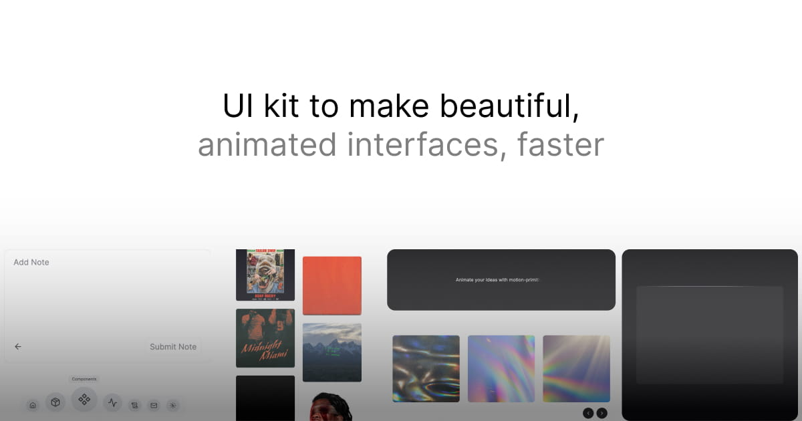

# Ndeko UI

Beautifully designed, easy-to-integrate motion components for engineers and designers, built with [motion](https://motion.dev/) and [Tailwind CSS](https://tailwindcss.com/).

**This project is in beta. Expect new components to be released regularly and significant updates to the code.**

## Documentation

Visit [ui.ndeko.dev/docs](http://ui.ndeko.dev/docs) to view the full documentation.

## Contributing

Please read the [contributing guide](/CONTRIBUTING.md).

## License

Licensed under the [MIT license](/LICENSE.md).
